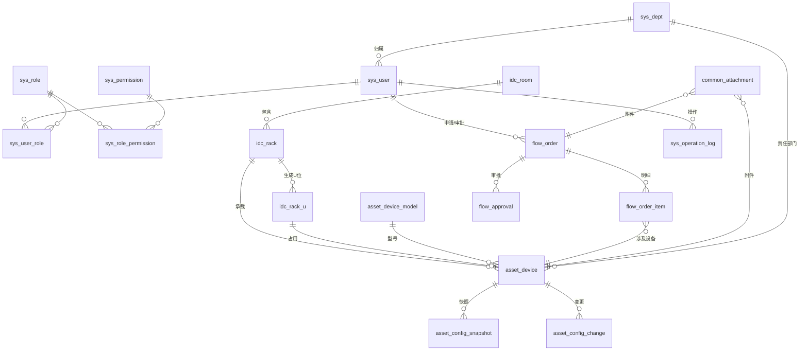
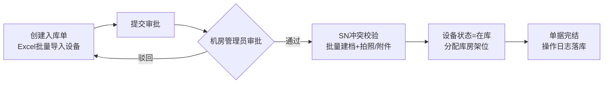
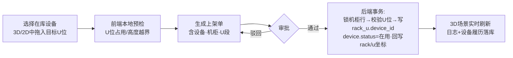

# CubeArk（立方仓）3D机房设备资产管理平台
# 阶段二：自研方案整体规划

> 版本：v1.0（2026-10-22）
> 依据：[阶段一_开源方案调研报告.md](阶段一_开源方案调研报告.md) 结论——**自研轻量骨架 + 精准复用开源模块**
> 目标部署：RedHat Enterprise Linux 8.10 / 192.168.8.68 / 无外网离线安装
> 示例访问地址：`http://192.168.8.68:8080`（Nginx 统一入口，端口可配置）

---

## 目录

1. [整体架构描述](#一整体架构描述)
2. [技术栈选型](#二技术栈选型)
3. [数据库 ER 设计与核心表结构](#三数据库er设计与核心表结构)
4. [核心业务流程说明](#四核心业务流程说明)
5. [前端 3D 方案对比与模型管理](#五前端-3d-方案对比与模型管理)
6. [开源复用策略与改造工作量](#六开源复用策略与改造工作量)
7. [开发里程碑与 MVP 范围](#七开发里程碑与-mvp-范围)
8. [风险清单](#八风险清单)

---

## 一、整体架构描述

### 1.1 架构总览（文字版）

```
┌─────────────────────────────────────────────────────────────────┐
│  浏览器（Chrome/Edge 90+，需 WebGL）                              │
│  ┌───────────────────────────┐  ┌────────────────────────────┐  │
│  │ 业务中后台（Vue3+ElementPlus）│  │ 3D机房引擎（Three.js）       │  │
│  │ 台账/流转/审批/权限/日志      │  │ 场景·相机·拾取·拖拽·热力图   │  │
│  └─────────────┬─────────────┘  └──────────────┬─────────────┘  │
└────────────────┼───────────────────────────────┼────────────────┘
                   │ HTTPS/REST(JSON)             │ 同一SPA内嵌
                   ▼                               ▼
┌─────────────────────────────────────────────────────────────────┐
│  Nginx（8080）：静态dist托管 + /api 反向代理 + 附件/模型静态服务      │
├─────────────────────────────────────────────────────────────────┤
│  业务服务层 cubeark-server（Go 单体·多模块，systemd 托管，:18080）  │
│  ┌────────┐ ┌────────┐ ┌────────┐ ┌────────┐ ┌──────────────┐   │
│  │认证授权 │ │机房资产 │ │出入流转 │ │配置快照 │ │审计日志        │   │
│  │JWT+RBAC│ │机房/机柜│ │单据/审批│ │版本/diff│ │全量操作留痕    │   │
│  │+数据范围│ │/U位/设备│ │状态机   │ │        │ │              │   │
│  └────────┘ └────────┘ └────────┘ └────────┘ └──────────────┘   │
│  ┌──────────────────────── 异步任务层 ─────────────────────────┐  │
│  │ 进程内 Worker Pool + robfig/cron 定时器：                     │  │
│  │ · Excel 批量导入/导出   · 配置快照定时比对与差异归档            │  │
│  │ · 操作日志按月归档清理  · 附件垃圾回收   · 统计报表预计算       │  │
│  │ （预留 asynq(Redis) 任务队列升级位，MVP 不引入消息中间件）      │  │
│  └────────────────────────────────────────────────────────────┘  │
├─────────────────────────────────────────────────────────────────┤
│  存储层                                                          │
│  · MySQL 8.0（AppStream，InnoDB/utf8mb4）—— 全部业务数据           │
│  · Redis 6（AppStream）—— 会话/令牌黑名单/RBAC缓存/分布式锁        │
│  · 本地文件存储 /opt/cubeark/data —— 附件、配置快照文件、glTF模型   │
└─────────────────────────────────────────────────────────────────┘
```

### 1.2 分层职责

| 层 | 组件 | 职责 |
|----|------|------|
| **3D 前端层** | Vue3 SPA 内嵌 Three.js 场景 | 机房/机柜/U位/设备四层 3D 渲染；单机柜视图与机房总览两级场景；点击拾取→设备详情；拖拽设备→U位预览与冲突检测；状态着色（在用/告警/空闲）；热力图叠加（预留温湿度数据接入） |
| **业务前端层** | Vue3 + Element Plus | 资产台账 CRUD、流转单工作台、审批中心、配置快照/diff、权限管理、日志查询、大屏仪表盘（ECharts） |
| **业务服务层** | Go 单体多模块 `cubeark-server` | REST API（`/api/v1/*`）；JWT 认证 + RBAC 授权 + 机房数据范围控制；流转单状态机（入库/出库/调拨/上架/下架/报废）；U位占用一致性校验（数据库唯一约束 + 行锁）；全量操作审计切面 |
| **异步任务层** | 进程内 Worker + cron | 耗时操作（Excel 导入导出、快照比对）异步化并落任务表可查进度；定时归档清理；统计预计算 |
| **存储层** | MySQL 8 / Redis 6 / 本地文件 | 结构化数据 / 缓存会话 / 非结构化文件（附件、快照原文、3D 模型） |

### 1.3 部署形态（单机裸机，非容器）

```
192.168.8.68 (RHEL 8.10)
├── nginx      :8080   systemd ── 托管 dist、反代 /api、静态模型/附件
├── cubeark-server :18080  systemd ── Go 静态二进制（CGO_ENABLED=0，零运行时依赖）
├── mysqld     :3306   systemd ── mysql 8.0（AppStream 离线rpm）
├── redis      :6379   systemd ── redis 6（AppStream 离线rpm）
└── /opt/cubeark/
    ├── app/         （cubeark-server 二进制、conf）
    ├── web/dist/    （前端静态产物）
    ├── data/        （附件/快照/上传，独立分区可备份）
    └── logs/        （应用日志，logrotate）
```

> 选裸机而非容器：单机规模下 systemd + 静态二进制 + AppStream rpm 的离线包比容器镜像离线导出（podman save/load + 存储 OverlayFS 排障）更简单、回滚更直接；RHEL8 自带 podman 可作为后期演进选项。

---

## 二、技术栈选型

### 2.1 后端语言选型对比（决策矩阵）

| 维度（权重） | **Go（推荐）** | Java 17 + Spring Boot | Python 3.11 + FastAPI |
|---|---|---|---|
| RHEL8.10 离线打包（×3） | ★★★★★ 静态单二进制，目标机零依赖 | ★★★☆☆ OpenJDK17 AppStream有rpm，离线中等 | ★★★☆☆ python3.11模块有，pip wheels需全量预打包 |
| 运行资源占用（×2） | ★★★★★ ~50MB 内存 | ★★☆☆☆ JVM 起步 ~500MB | ★★★☆☆ |
| 并发/3D数据推送（×1） | ★★★★★ goroutine 天然 | ★★★★☆ | ★★★☆☆ |
| Excel/文件处理生态（×1） | ★★★★☆ excelize 成熟 | ★★★★★ | ★★★★★ |
| 开发效率（×2） | ★★★★☆ | ★★★★★ | ★★★★★ |
| 与复用项匹配（×1） | ★★★★☆ 3d-idc-visual 同为Go（对标方便） | ★★★☆☆ | ★★★☆☆ |
| **加权总分** | **33/35** | 27/35 | 27/35 |

**决策：Go 1.22+ / Gin / GORM**。
理由：离线交付是本项目硬约束，Go `CGO_ENABLED=0` 编译产物为单个静态二进制，彻底消除"目标机缺运行时"这一类风险；单体多模块（internal/ 按域拆包）保证结构清晰，后期可平滑拆微服务。

### 2.2 技术栈清单（锁定原则：版本在方案冻结时 pin 死并写入交付清单）

| 层 | 选型 | 版本基线 | RHEL8.10 获取方式（离线） |
|----|------|---------|--------------------------|
| 前端框架 | Vue 3 + TypeScript + Vite | 3.4+ / 5.x | 开发机构建 dist，目标机仅需 Nginx |
| 业务 UI | Element Plus + Pinia + Vue Router | 2.x | 同上 |
| 图表 | ECharts 5 | 5.x | 同上 |
| **3D 引擎** | **Three.js（原生 API）** | r1xx（冻结时锁定） | 同上 |
| 后端 | Go + Gin + GORM + golang-jwt + excelize | 1.22+ | 开发机交叉编译 linux/amd64 静态二进制 |
| 数据库 | MySQL | **8.0**（AppStream 模块） | 离线 rpm 仓库 |
| 缓存 | Redis | 6（AppStream 模块） | 离线 rpm 仓库 |
| Web 服务 | Nginx | 1.20+（AppStream） | 离线 rpm 仓库 |
| 进程管理 | systemd（unit 文件随包交付） | 系统自带 | — |
| 代码托管 | Gitee 私有仓库（与调研源一致） | — | — |

> 密码与所有环境相关配置一律通过安装包内 `install.conf`（变量传入）+ 环境变量注入，**代码与脚本不硬编码密码**；手册示例标注 `root / Passw0rd.1`。

---

## 三、数据库ER设计与核心表结构

### 3.1 ER 总览



命名规范：`sys_` 系统权限 / `idc_` 机房物理 / `asset_` 资产配置 / `flow_` 出入流转 / `common_` 通用。所有表含公共字段：`id BIGINT PK AUTO_INCREMENT`、`created_at`、`updated_at`、`deleted_at`（软删，加索引）。

### 3.2 核心表结构（关键字段与索引；完整建表 SQL 为下一交付物）

#### 机房物理域

**idc_room 机房（含楼层）**

| 字段 | 类型 | 说明 |
|------|------|------|
| code | varchar(32) UK | 机房编码 |
| name | varchar(64) | 机房名称 |
| floor | varchar(16) | 楼层 |
| address / remark | varchar | 位置/备注 |
| status | tinyint | 启用/停用 |

索引：`UK(code)`；`IDX(deleted_at)`

**idc_rack 机柜**

| 字段 | 类型 | 说明 |
|------|------|------|
| room_id | bigint | 所属机房 FK |
| code | varchar(32) | 机柜编号（机房内唯一） |
| row_no / col_no | int | 排/列（A/B/C列规划用） |
| u_total | smallint | U 高度（42/47…） |
| pos_x / pos_y / pos_z | decimal(8,2) | **3D 场景坐标** |
| rotation_y | decimal(6,2) | 朝向角 |
| power_kw / remark | decimal | 额定功率/备注 |
| status | tinyint | 启用/停用 |

索引：`UK(room_id, code)`；`IDX(room_id)`；`IDX(row_no, col_no)`

**idc_rack_u U位**

| 字段 | 类型 | 说明 |
|------|------|------|
| rack_id | bigint | 所属机柜 FK |
| u_no | smallint | U 位号（从下往上 1..u_total） |
| device_id | bigint NULL | 占用设备（NULL=空闲） |
| status | tinyint | 空闲/占用/预留 |

索引：**`UK(rack_id, u_no)`**；`UK(device_id, u_no)` 防跨机柜重复占用（应用层保证 device 连续段，DB 层用 `UK(device_id)` 方案二选一，建表SQL阶段定稿）；`IDX(status)`

> U 位在**机柜创建时批量生成**、机柜扩容时补齐；上架/移位只 update `device_id`，3D 与 2D 视图直接读该表，天然一致。

#### 资产配置域

**asset_device_model 设备型号（NetBox DeviceType 思路）**

| 字段 | 类型 | 说明 |
|------|------|------|
| vendor | varchar(64) | 厂商 |
| model | varchar(64) | 型号 |
| category | tinyint | 服务器/交换机/PDU/存储/其他 |
| u_height | smallint | 占用 U 高度 |
| depth_mm / power_w | int | 深度/额定功率 |
| face_port_json | json | 前/后面板端口模板（3D面板渲染用） |
| model3d_key | varchar(64) | 关联 3D 模型库键（见 §5.4） |

索引：`UK(vendor, model)`；`IDX(category)`

**asset_device 资产设备台账（核心表）**

| 字段 | 类型 | 说明 |
|------|------|------|
| sn | varchar(64) **UK** | 序列号（全库唯一） |
| name / hostname | varchar(64) | 资产名称/主机名 |
| model_id | bigint FK | 型号 |
| category | tinyint | 冗余型号分类（查询加速） |
| status | tinyint | **在库/在用/维修/备用/报废**（状态机见 §4） |
| rack_id | bigint NULL | 所在机柜（在库时为 NULL） |
| u_start / u_end | smallint NULL | 起始/结束 U（在库时为 NULL） |
| room_id | bigint NULL | 冗余机房（列表过滤加速） |
| manage_ip | varchar(64) | 管理 IP |
| owner_dept_id / owner_user | bigint / varchar | 责任部门/责任人 |
| warranty_start / warranty_end | date | 维保起止 |
| purchase_date / price | date / decimal | 采购日期/价格 |
| ext_json | json | 自定义扩展属性 |

索引：`UK(sn)`；`IDX(status, category)`；`IDX(rack_id, u_start)`；`IDX(owner_dept_id)`；`IDX(warranty_end)`（维保到期提醒）；`IDX(manage_ip)`

**asset_config_snapshot 配置快照**

| 字段 | 类型 | 说明 |
|------|------|------|
| device_id | bigint FK | 设备 |
| version | int | 版本号（设备内自增，UK(device_id,version)） |
| source | tinyint | 手工录入/批量导入/自动采集 |
| content | longtext | 快照原文（JSON/文本，大文本可转文件存储） |
| file_path | varchar(255) | 快照文件路径（可选，大快照落盘） |
| hash | char(32) | 内容 MD5（去重、变更判断） |
| created_by | bigint | 录入人 |

索引：`UK(device_id, version)`；`IDX(hash)`

**asset_config_change 配置变更历史**

| 字段 | 类型 | 说明 |
|------|------|------|
| device_id | bigint FK | 设备 |
| from_version / to_version | int | 旧/新版本 |
| diff_summary | text | 差异摘要（结构化 diff） |
| related_order_no | varchar(32) | 关联流转单号（可空，串起"谁在何时因何变更"） |
| created_by / created_at | | 操作人/时间 |

索引：`IDX(device_id, to_version)`；`IDX(related_order_no)`

#### 出入流转域

**flow_order 出入库流转单**

| 字段 | 类型 | 说明 |
|------|------|------|
| order_no | varchar(32) **UK** | 单号（RK/CK/DB/SJ/XJ/BF+日期+序号） |
| order_type | tinyint | 入库/出库/调拨/上架/下架/报废 |
| status | tinyint | 草稿/待审批/审批中/已驳回/已完成/已取消 |
| applicant_id | bigint | 申请人 |
| from_room_id / to_room_id | bigint NULL | 调拨双方机房（按类型选填） |
| expect_date / finish_time | datetime | 期望/实际完成时间 |
| reason / remark | varchar | 事由 |

索引：`UK(order_no)`；`IDX(order_type, status)`；`IDX(applicant_id, created_at)`；`IDX(status, created_at)`（待办工作台）

**flow_order_item 流转明细**

| 字段 | 类型 | 说明 |
|------|------|------|
| order_id | bigint FK | 主单 |
| device_id | bigint FK | 设备 |
| from_location | varchar(128) | 变更前位置（机房-机柜-U / 库房架位） |
| to_location | varchar(128) | 变更后位置 |
| before_status / after_status | tinyint | 设备状态变迁 |
| exec_result | tinyint | 成功/失败/冲突跳过 |

索引：`UK(order_id, device_id)`；`IDX(device_id)`（设备履历反查）

**flow_approval 审批记录**

| 字段 | 类型 | 说明 |
|------|------|------|
| order_id | bigint FK | 主单 |
| node_seq | smallint | 审批节点序号 |
| approver_id | bigint | 审批人（或角色占位） |
| action | tinyint | 同意/驳回/撤回 |
| comment | varchar(512) | 审批意见 |
| acted_at | datetime | 操作时间 |

索引：`UK(order_id, node_seq)`；`IDX(approver_id, acted_at)`

> 审批流 MVP 采用**单级审批**（申请人→机房管理员审批→执行），表结构按多级（node_seq）设计留足扩展；审批通过后由后端在同一事务内执行 U 位/状态变更并回写 exec_result。

#### 系统权限域

**sys_dept 部门/分组**：id, parent_id(树), name — `IDX(parent_id)`
**sys_user 用户**：id, username(UK), password_hash(bcrypt), real_name, mobile, email, dept_id, status(锁定/启用), last_login_at, fail_count — `UK(username)`；`IDX(dept_id)`
**sys_role 角色**：id, code(UK), name, data_scope(全部/本部门/指定机房) — `UK(code)`
**sys_user_role**：user_id, role_id — `UK(user_id, role_id)`
**sys_permission 权限点**：id, code(UK 如 `device:create`), name, module — `UK(code)`
**sys_role_permission**：role_id, permission_id — `UK(role_id, permission_id)`
**sys_role_room（数据范围-机房授权）**：role_id, room_id — `UK(role_id, room_id)` —— 实现机房级数据隔离（对标 3d-idc-visual 的数据中心范围控制）

**sys_operation_log 操作日志（全量审计，只增不改）**

| 字段 | 类型 | 说明 |
|------|------|------|
| user_id / username | | 操作人（冗余名，防用户删除后失义） |
| module | varchar(32) | asset / flow / idc / system |
| action | varchar(64) | device:create / order:approve … |
| target_type / target_id | | 对象类型/ID（device/order/rack…） |
| detail | json | 请求关键参数与变更前后摘要 |
| ip / user_agent | varchar | 来源 |
| result | tinyint | 成功/失败 |

索引：`IDX(user_id, created_at)`；`IDX(module, action)`；`IDX(target_type, target_id)`；`IDX(created_at)`（按月分区或定期归档）

#### 通用域

**common_attachment 附件**：id, biz_type(order/device/snapshot), biz_id, file_name, file_path, file_size, file_hash, uploader_id — `IDX(biz_type, biz_id)`；`UK(file_hash, biz_type)` 可选去重

**biz_task 异步任务（Excel导入导出等）**：id, task_type, status(排队/执行/成功/失败), progress, result_file, param_json, requested_by — `IDX(status)`；`IDX(requested_by, created_at)`

---

## 四、核心业务流程说明

### 4.1 设备状态机（全局）

```
在库(WAREHOUSE) ──上架──▶ 在用(IN_USE) ──下架──▶ 在库
   │                        │
   ├──出库──▶ 已出库(OUT)     ├──报修──▶ 维修(REPAIR) ──修复──▶ 在库/在用
   │                        │
   └──报废申请──▶ 报废(SCRAPPED，终态，保留台账只读)  ◀──报废申请──┘
调拨 = 下架+移动+上架 的组合单据（同单审批，两阶段执行）
```

### 4.2 入库流程



### 4.3 上架流程（3D 拖拽入口与表单入口同源）



### 4.4 下架流程：与上架对称（在用→在库，释放 `idc_rack_u.device_id`，设备回到库房架位）。

### 4.5 调拨流程


### 4.6 报废流程：申请（选择设备+原因+附件）→ 审批 → 执行（状态=报废·释放U位·台账转只读·保留全部历史）；终态不可逆，仅管理员可物理删除（软删标记）。

> 所有流转单均支持：附件上传、审批意见、执行结果回写、设备履历反查（`flow_order_item.device_id` 时间轴）。

---

## 五、前端 3D 方案对比与模型管理

### 5.1 渲染方案对比

| 方案 | 优点 | 缺点 | 结论 |
|------|------|------|------|
| **A. Three.js 原生（Vue3 组件内命令式封装）** ✅推荐 | 依赖最少；渲染循环/内存释放完全可控；机房场景以盒体为主，无需复杂声明式树；国内机房案例与教程最多 | 与 Vue 响应式需手动桥接（封装约 200 行胶水） | **MVP 采用**：封装 `useThreeScene()` 组合式 API，场景对象与业务数据手动同步 |
| B. TresJS（Vue3 声明式 Three.js） | Vue 模板化写 3D，心智一致；TvT.js 生态可借鉴 | 引入胶水层版本耦合；大规模动态对象（千级U位）响应式开销需验证；机房垂类组件仍需自写 | 作为 A 的演进备选（若后期做低代码编辑器再引入） |
| C. React Three Fiber + 复用 go-laoji 组件 | 可直接抄 go-laoji 机柜/热力图组件 | 整个前端被迫选 React + Umi 技术栈；与 Element Plus/Vue 生态割裂 | 仅当前端团队为 React 栈时才考虑 |
| D. 商业引擎（ThingJS/图扑） | 成熟机房组件 | 闭源商用，违反"只开源自研"约束 | 排除 |

### 5.2 3D 场景分层设计

- **L1 机房总览**：地面网格 + 机柜阵列（实例化 `InstancedMesh`，单 draw call 渲染数百机柜）+ 机柜状态色（空间占用率/告警）+ 楼层切换；
- **L2 机柜正视**：单机柜放大视图，U 位槽逐格渲染（颜色=空闲/占用/告警），支持**拖拽设备入格**（射线拾取 + 网格吸附 + 冲突红显——对标 3d-idc-visual 交互）；
- **L3 设备详情**：点击设备弹出面板（2D 侧栏 + 3D 局部模型），前/后面板端口按 `asset_device_model.face_port_json` 参数化渲染。

### 5.3 性能预算（大批量资产防卡顿）

| 措施 | 目标 |
|------|------|
| 机柜用 `InstancedMesh`、设备盒体合并 `BufferGeometry` | 千级机柜/万级U位保持 30+ FPS |
| 超过阈值（如 >2000 设备）总览自动降级：设备以色块呈现，进 L2 才加载细节 | 首屏 <3s |
| 场景视锥剔除 + 按机房分场景懒加载 | 内存 <500MB |
| 业务列表虚拟滚动 + 后端分页（50/页）+ `IDX` 支撑 | 万级台账秒级查询 |
| 3D 数据接口与列表接口分离（`/api/v1/scene/room/{id}` 一次吐全场景 JSON，Redis 缓存 60s，写操作主动失效） | 拖拽/刷新不卡 |

### 5.4 模型轻量化与模型管理方案

1. **参数化建模为主（90% 场景）**：机柜/服务器/交换机/PDU 均由代码按尺寸参数生成立方体组合（贴 front 面板贴图/线框），**零美术资产依赖**，与 `asset_device_model` 尺寸字段联动——这是离线可交付的关键（无需携带大模型库）；
2. **精模为辅（设备详情弹窗）**：少量高保真 glTF 模型（gltf+Draco 压缩，单模型 <1MB），存于 `/opt/cubeark/data/models/`，通过 `asset_device_model.model3d_key` 映射；缺失时自动回退参数化盒体；
3. **模型库管理**：管理端"型号-模型映射"页，支持上传 `.gltf/.glb`（自动 Draco 压缩校验）、预览、绑定型号；文件哈希入 `common_attachment` 统一管理。

---

## 六、开源复用策略与改造工作量

> 本方案为"自研骨架 + 模块级复用"，非 fork 整项目，无许可合规负担（复用项均为 MIT/Apache-2.0 或仅设计借鉴）。

| 复用来源 | 复用什么 | 怎么复用 | 工作量评估 |
|----------|----------|----------|-----------|
| go-laoji/3d-datacenter (MIT) | 机柜 3D 组件思路：U位标尺、状态着色、告警闪烁、设备面板渲染、机柜布局图 | **读源码→用 Three.js 原生按本项目分层重写**（React→Vue 概念移植，不逐行翻译） | 3D 场景模块总量的 ~30% 省去探索成本 |
| 3d-idc-visual（无许可，仅对标） | 产品/交互设计：2D U位拖拽+冲突检测+显式保存、3D设备详情分组、机房范围权限、上下架统计 | 逐页截图研究，输出原型图；**不复制任何代码** | 交互设计少走弯路，约省 1-2 周返工 |
| NetBox (Apache-2.0) | ER 模型：Room/Rack/Device/U位/DeviceType 建模与状态枚举 | 表结构设计参照（§3 已落地） | 设计期收益，0 运行时依赖 |
| Ralph + Snipe-IT（Apache/AGPL，仅设计） | 流转单据模型：stock↔deployed 生命周期、checkout/checkin 单据+履历轴 | §3 flow_* 三表已吸收其思想；不引入代码 | 同上 |
| veops/cmdb (Apache-2.0) | 部署脚本骨架、MySQL sql_mode 初始化等工程细节 | 阶段三打离线包时参考其 compose/Makefile 结构 | 部署阶段收益 |

**重写/自研范围**：全部后端业务（认证、资产、流转、审批、快照、审计）、Vue3 业务前端、Three.js 场景封装、离线安装包全套脚本。

---

## 七、开发里程碑与 MVP 范围

### 7.1 MVP 定义（最小可用版本 = M1+M2 合并验收）

- ✅ 登录 + 用户/角色/权限 + 机房数据范围
- ✅ 机房/机柜/U位管理（含 3D 坐标）、型号库
- ✅ 设备台账 CRUD + Excel 批量导入导出
- ✅ 3D 机房总览 + 单机柜 U 位视图（只读渲染 + 点击详情）
- ✅ 入库/上架/下架 三条流程（单级审批 + 附件）
- ✅ 全量操作日志查询
- ⛔ 不在 MVP：调拨/报废（M2）、拖拽上架交互（M3）、配置快照 diff（M2）、大屏、热力图（M3+）

### 7.2 里程碑（总计约 14 周，2 人全栈当量；可按人力并行压缩）

| 里程碑 | 周期 | 交付内容 | 验收标准 |
|--------|------|----------|----------|
| **M0 方案冻结** | 1 周 | 本文档评审定稿、技术版本 pin 死、Gitee 仓库/CI、开发环境 | 评审通过 |
| **M1 地基** | 3 周 | 后端框架（认证/RBAC/审计切面）+ 前端框架 + 机房/机柜/U位/型号/台账 API 与页面 | 脚手架跑通，台账可录入 |
| **M2 流程与配置** | 3 周 | 入库/出库/调拨/上架/下架/报废全流程 + 审批 + 附件；配置快照与变更历史 | 六流程端到端走通 |
| **M3 3D 场景** | 3 周 | L1/L2 场景、参数化建模、拖拽上架、状态着色、大屏 | 千机柜 30FPS、拖拽可用 |
| **M4 打磨** | 2 周 | Excel 全量、性能优化、权限边界测试、缺陷修复 | 用例全过 |
| **M5 离线交付** | 2 周 | 离线安装包 + 部署手册 + 用户手册，192.168.8.68 无外网演练 | 断网重装成功 |

---

## 八、风险清单

| # | 风险 | 等级 | 影响 | 缓解措施 |
|---|------|------|------|----------|
| R1 | **RHEL8.10 依赖坑**：默认 python3.6 过老、glibc 2.28 限制新二进制、AppStream 模块版本切换冲突 | 高 | 离线包装不上 | 全链路避免目标机 Python 依赖（Go 静态二进制）；前端 dist 纯静态；MySQL/Redis/Nginx 全走 AppStream 离线 rpm 并锁版本；在 RHEL8.10 容器/虚机内做打包验证 |
| R2 | **3D 渲染性能**：低端核显 workstation 掉帧、WebGL 上下文丢失 | 中 | 大机房体验差 | InstancedMesh/降级策略（§5.3）；WebGL 上下文丢失自动重建；最低硬件基线写入手册 |
| R3 | **大批量资产卡顿**：万级设备列表与 3D 双向卡顿 | 中 | 数据增长后不可用 | 列表分页+虚拟滚动+覆盖索引；3D 场景按机房分片懒加载；场景接口 Redis 缓存 |
| R4 | **权限审计疏漏**：越权改数据、日志缺失 | 高 | 合规风险 | 后端统一 RBAC 中间件+数据范围注入；审计切面在框架层强制（业务代码无法绕过）；日志表只增不改+月度归档 |
| R5 | **离线依赖缺失**：打包遗漏运行库/字体/CA 证书 | 高 | 现场安装失败 | 维护"离线物料清单"（BOM）并在干净 RHEL8.10 虚机做**两轮全量演练**（安装+卸载重装） |
| R6 | U 位并发冲突：两人同时拖同一 U 位 | 中 | 数据不一致 | DB 唯一约束兜底 + 机柜行锁（`SELECT ... FOR UPDATE`）+ 冲突友好提示 |
| R7 | 浏览器兼容：政企内网旧版浏览器无 WebGL | 中 | 3D 打不开 | 明确支持 Chrome/Edge 90+；提供 2D 机柜视图完整兜底（所有 3D 操作在 2D 均可用） |
| R8 | 单人维护 go-laoji 类参考项目失效 | 低 | 复用源消失 | 复用即"读代码吸收"，不建立运行时依赖；关键思路已在本文档沉淀 |
| R9 | 快照大文本拖慢库表 | 低 | 查询变慢 | 快照 >64KB 落文件存储，库内仅存 hash+路径 |
| R10 | 密码/密钥硬编码泄漏 | 中 | 安全事故 | 全部走 install.conf 变量 + 环境变量；交付前 `gitleaks` 扫描 |

---

## 九、下一步（阶段三衔接）

按 REDME.md 约定，后续依次交付：
1. **数据库建表 SQL**（§3 全部 17+ 表的完整 DDL + 初始化数据）
2. REST 接口文档（OpenAPI 风格）
3. 前端 3D Demo 代码
4. RHEL8.10 部署脚本
5. 离线打包脚本 + 《离线部署手册》《用户使用手册》

---

*本文档为 CubeArk 项目阶段二交付物，评审通过后进入 M0→M1 开发。*
